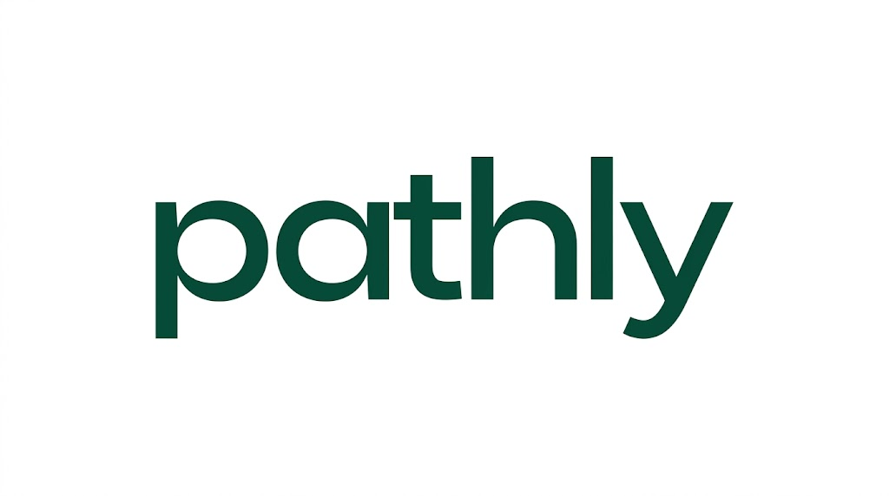

# Pathly – Brand Identity

> **Stand:** 03.11.2026 · **Domain:** [pathly.info](https://pathly.info) · **Umsetzung:** `apps/web`
>
> Verbindliche Grundlage für Website, App, Präsentationen und Social Media.
> Die Werte hier sind 1:1 im Code hinterlegt (`apps/web/src/app/globals.css`).

---

## Inhalt

1. [Markenkern](#1-markenkern)
2. [Persönlichkeit & Tonalität](#2-persönlichkeit--tonalität)
3. [Logo](#3-logo)
4. [Farben](#4-farben)
5. [Barrierefreiheit & Kontraste](#5-barrierefreiheit--kontraste)
6. [Typografie](#6-typografie)
7. [Formen, Raster & Layout](#7-formen-raster--layout)
8. [Komponenten](#8-komponenten)
9. [Bewegung](#9-bewegung)
10. [Bildsprache](#10-bildsprache)
11. [Umsetzung im Code](#11-umsetzung-im-code)

---

## 1. Markenkern

| | |
|---|---|
| **Name** | Pathly (Wortmarke immer klein: `pathly`; im Fließtext „Pathly“) |
| **Claim** | Klarheit für deine Studienwahl. |
| **Versprechen** | Pathly ordnet, was sonst verstreut ist: Hochschulen, Studiengänge, Zulassung und Kosten – klar, nachvollziehbar und aus offiziellen Quellen. |
| **Zielgruppe** | Studieninteressierte, Studierende vor dem Master, Menschen mit ungewöhnlichen Bildungswegen |
| **Leitidee** | Klarheit. Jede Seite soll ruhiger wirken als die Suche, die sie ersetzt. |

**Markenwerte** (abgeleitet aus den Leitprinzipien im [Feature-Katalog](feature-katalog.md#2-leitprinzipien)):

1. **Klar** – eine Aussage pro Abschnitt, viel Weißraum, keine Reizüberflutung.
2. **Belegt** – offizielle Quellen sind maßgeblich, die Herkunft ist immer sichtbar.
3. **Ehrlich** – keine Garantien, Aussagen probabilistisch formuliert.
4. **Offen** – auch ungewöhnliche Wege sind legitim.

---

## 2. Persönlichkeit & Tonalität

Pathly klingt wie eine kluge, ruhige ältere Freundin, die sich auskennt: **klar, warm, ehrlich, auf Augenhöhe.**

| Regel | So | Nicht so |
|---|---|---|
| Wir duzen | „Finde deine Hochschule“ | „Finden Sie Ihre Hochschule“ |
| Verb zuerst, kurz | „Hochschulen entdecken“ | „Hier klicken, um Hochschulen zu entdecken“ |
| Keine Versprechen | „Profile mit X haben typischerweise bessere Chancen auf Y“ | „Mit uns bekommst du deinen Studienplatz“ |
| Quelle nennen | „laut Bayerischem Staatsministerium, abgerufen am …“ | „bekanntlich …“ |
| Fehler = was passiert + was tun | „Die Hochschulen konnten nicht geladen werden. Versuch es gleich noch einmal.“ | „Error 500“ |
| Leerzustände laden ein | „Probier einen kürzeren Suchbegriff.“ | „Nichts gefunden!!“ |

- Satzanfang groß, sonst normale deutsche Rechtschreibung – keine GROSSBUCHSTABEN-Überschriften.
- Keine Ausrufezeichen in Systemtexten, keine Füllwörter („einfach“, „nur“, „ganz leicht“).
- Zahlen mit deutschem Format: `1.234`, Datum `2.10.2026`.

---

## 3. Logo

**Aufbau:** Reine Wortmarke `pathly` in Pathly Grün (`#044B39`), klein geschrieben, ohne Bildzeichen.
Ruhig und klar – die Farbe kommt aus der Umgebung (Schimmer, Akzente), nicht aus dem Logo.

| Variante | Einsatz | Datei |
|---|---|---|
| **Wortmarke dunkel** (Standard) | auf Weiß, Lime, Minze | `apps/web/public/brand/pathly-logo.png` |
| **Wortmarke weiß** | auf `#044B39` / `#053438` | `apps/web/public/brand/pathly-logo-white.png` |
| **Signet „p“** | Favicon, App-Icon, Avatar – weißes „p“ aus der Wortmarke auf `#044B39`, abgerundetes Quadrat | `apps/web/src/app/icon.png`, `apple-icon.png`, `favicon.ico` |
| **Vorschaubild** | Link-Vorschau (Social Media, Messenger) 1200×630 | `apps/web/src/app/opengraph-image.png` |

Alle Dateien entstehen aus dem Original (`docs/brand/pathly-logo-original.png`) mit
`python scripts/build-brand-assets.py` (in `apps/web`). Dabei wird der weiße Hintergrund transparent
und die Schrift wird exakt auf `#044B39` gesetzt. **Nie die erzeugten Dateien von Hand bearbeiten** –
Original tauschen und Skript erneut ausführen.

Regeln:

- **Einfarbig:** nur `#044B39` auf hellen Flächen oder Weiß auf dunklen – keine weiteren Farben oder Verläufe in der Schrift.
- **Schutzraum:** rundum mindestens die Höhe des „a“.
- **Mindestgröße:** Wortmarke 24 px Höhe digital (Website: 32 px). Darunter das Signet verwenden.
- **Nicht:** verzerren, drehen, Buchstaben einzeln einfärben, Schatten/Glow hinzufügen, auf unruhige Fotos ohne Fläche setzen.

> **Offen:** Das Original ist eine Rastergrafik (PNG, 1024 px). Für Druck, große Formate und gestochen
> scharfe Darstellung braucht es noch eine **Vektor-Datei (SVG/PDF)** aus dem Design-Tool, in dem das Logo
> entstanden ist. Sobald sie da ist, ersetzt sie das PNG als Master.

---

## 4. Farben

### Palette

| Swatch | Name | Hex | Rolle | Token |
|---|---|---|---|---|
|  | **Pathly Grün** | `#044B39` | Primärfarbe: Überschriften, Buttons, Logo | `--primary`, `--brand-primary` |
|  | **Tiefsee** | `#053438` | Fließtext, dunkle Flächen | `--foreground`, `--brand-forest` |
|  | **Signalgrün** | `#72C613` | Akzent: hervorgehobenes Wort, CTA-Punkt | `--brand-green` |
|  | **Lime** | `#CBF39D` | Schimmer, Verläufe, Flächen | `--brand-lime` |
|  | **Minze** | `#C8EFC1` | Hover-Flächen, „Live“-Badge, sekundäre Flächen | `--accent`, `--secondary`, `--brand-mint` |
|  | **Smaragd** | `#1EA97B` | Fokus-Ring, Diagramme | `--ring`, `--chart-1`, `--brand-emerald` |
|  | **Oliv** | `#264B04` | Diagramme, dunkler Akzent in Grafiken | `--chart-5`, `--brand-olive` |
|  | **Blau** | `#2180E6` | Info-Zustände, Diagramme – sparsam | `--chart-3`, `--brand-blue` |
|  | **Aqua** | `#BDF0EC` | „In Arbeit“-Badge, Text auf Tiefsee | `--brand-aqua`, `--brand-forest-foreground` |
|  | **Creme** *(Verlauf)* | `#F6F3B8` | nur im Lime-Creme-Verlauf | `--brand-cream` |

Neutrale UI-Farben: Hintergrund `#FFFFFF`, Linien `#DCE8E2`, Eingabefelder `#CFE0D8`, gedämpfte Flächen `#F3F8F1`, Sekundärtext `#4A6A66`.

### Gewichtung

Ungefähr **70 % Weiß · 20 % Grüntöne (`#044B39`/`#053438`) · 10 % Lime/Signalgrün.**
Lime ist eine Bühne, kein Hintergrundrauschen: höchstens eine Lime-Vollfläche pro Seite.

### Verläufe

- **Schimmer (Hero):** Lime fällt von oben, diagonal nach Creme auslaufend, weichgezeichnet –
  `radial-gradient(ellipse 70% 60% at 45% 0%, #CBF39D 30%, transparent 75%)` +
  `linear-gradient(160deg, #CBF39D 25%, #F6F3B8 60%, transparent 85%)`, Blur bis 56 px.
- **CTA-Fläche:** Lime steigt von unten auf – `radial-gradient(ellipse 60% 80% at 50% 100%, #CBF39D, transparent 70%)`.
- Keine weiteren Verläufe, keine Neon- oder Glow-Effekte auf Schrift.

---

## 5. Barrierefreiheit & Kontraste

Ziel: **WCAG 2.2 AA** (Text ≥ 4,5:1, große Schrift ≥ 3:1, UI-Elemente ≥ 3:1).

| Vordergrund | Hintergrund | Kontrast | Einsatz |
|---|---|---|---|
| `#053438` | `#FFFFFF` | **13,5:1** ✅ | Fließtext |
| `#044B39` | `#FFFFFF` | **10,1:1** ✅ | Überschriften, Buttons |
| `#4A6A66` | `#FFFFFF` | **5,9:1** ✅ | Sekundärtext |
| `#FFFFFF` | `#044B39` | **10,1:1** ✅ | Button-Beschriftung |
| `#044B39` | `#CBF39D` | **8,1:1** ✅ | Text auf Lime |
| `#044B39` | `#C8EFC1` | **8,0:1** ✅ | Hover, Badges |
| `#BDF0EC` | `#053438` | **10,8:1** ✅ | Text auf dunklen Flächen |
| `#72C613` | `#044B39` | **4,7:1** ✅ | Signalgrün auf Dunkelgrün |
| `#2180E6` | `#FFFFFF` | 4,0:1 ⚠️ | nur große Schrift/Icons |
| `#1EA97B` | `#FFFFFF` | 3,0:1 ⚠️ | nur Fokus-Ring/Grafik, kein Text |
| `#72C613` | `#FFFFFF` | **2,1:1** ❌ | siehe Regel unten |
| `#72C613` | `#CBF39D` | **1,7:1** ❌ | nie als Text |

**Regel Signalgrün:** `#72C613` ist auf hellem Grund **kein Textträger**. Erlaubt ist es nur als
Punkt, Linie, Fläche, auf `#044B39` und als kurzes Zwischenstadium in Animationen.
**Bekannte Ausnahme:** Das hervorgehobene Wort in der Hero-Überschrift („Studienwahl“) nutzt
Signalgrün bewusst als Gestaltungsmittel und liegt damit unter AA. Der Satz bleibt ohne
Farbe verständlich. Wer strikt AA braucht, setzt das Wort in `#044B39` und unterstreicht es mit
einer Signalgrün-Linie.

Weitere Regeln: sichtbarer Fokus-Ring (`#1EA97B`, 3 px), Animationen respektieren
„Bewegung reduzieren“ (siehe [Bewegung](#9-bewegung)), Links und Buttons haben klare Hover-Zustände.

---

## 6. Typografie

| | |
|---|---|
| **Schrift** | **Geist Sans** (Text, Überschriften) · **Geist Mono** (Zahlen in Tabellen, Code) – lizenzfrei, selbst gehostet über `next/font` |
| **Charakter** | groß, leicht, eng gesetzt – Klarheit entsteht durch Größe, nicht durch Fettung |

| Stufe | Größe (Mobil → Desktop) | Gewicht | Laufweite | Zeilenhöhe |
|---|---|---|---|---|
| Display (Hero) | 48 → 72 px | 400 | −0,025 em | 1,05 |
| H2 | 36 → 48 px | 400 (dunkle Flächen: 300) | −0,025 em | 1,15 |
| H3 / Kartentitel | 16–20 px | 500 | normal | 1,4 |
| Fließtext | 16–18 px | 400 | normal | 1,6 |
| Klein / Labels | 14 px | 400–500 | normal | 1,5 |

- Hervorhebung über **Farbe** (ein Wort), nicht über Fettdruck.
- Maximal **ein** hervorgehobenes Wort pro Überschrift.
- Zeilenlänge Fließtext max. ~70 Zeichen (`max-w-xl`/`max-w-2xl`).

---

## 7. Formen, Raster & Layout

| Element | Form |
|---|---|
| Navigation, CTA, Badges | **Pille** (`rounded-full`) |
| Karten, Items | 16 px Radius (`rounded-2xl`) |
| Große Flächen (z. B. CTA-Box) | 32 px Radius (`rounded-[2rem]`) |
| Eingabefelder, kleine Buttons | 12 px Radius (`--radius: 0.75rem`) |

- **Inhaltsbreite** max. 1152 px (`max-w-6xl`), Seitenrand 16 px mobil / 24 px Desktop.
- **Raster-Linien** statt Schatten: dünne Linien `#DCE8E2` gliedern Bereiche (Hero-Trennlinie, Logo-/Länder-Raster).
- **Schatten** nur an der schwebenden Navigation (`shadow-sm`).
- **Weißraum:** Abschnitte mit 96 px Abstand oben/unten (`py-24`).

---

## 8. Komponenten

Die Oberfläche nutzt **ausschließlich shadcn/ui-Komponenten** (Stil `base-nova`, Base UI), installiert per
`npx shadcn add`. Eigene Markups nur für Seitenlayout und Marken-Elemente.

| Muster | Umsetzung |
|---|---|
| **Marken-CTA** | dunkelgrüne Pille mit Pfeil im Signalgrün-Kreis; beim Hovern wächst der Kreis leicht und der Pfeil gleitet nach rechts (`components/cta-button.tsx`) |
| **Navigation** | schwebende weiße Pille; rechts „Anmelden“ (ghost) und „Registrieren“ (outline), der grüne CTA gleitet auf der Startseite nach dem Hero dazu |
| **Status-Badges** | Live = Minze/`#044B39` · In Arbeit = Aqua/`#053438` · Geplant = neutral |
| **Hover** | Minze-Fläche + `#044B39`-Text (Buttons, Items), Karten zusätzlich mit grünem Rahmen |
| **Suche** | Input Group mit Lupe und Button in einer Zeile |
| **Leerzustände** | Empty mit Icon, kurzer Erklärung und einer Aktion |

---

## 9. Bewegung

Bewegung erzählt den Weg von **Verstreut → Geordnet**. Sie ist langsam, weich und nie verspielt.

| Moment | Verhalten | Timing |
|---|---|---|
| **Intro** | Seite startet weiß; Überschrift baut sich Buchstabe für Buchstabe auf (auftauchen + entschärfen) | 700 ms je Zeichen, 22 ms versetzt, `ease-out` |
| **Schimmer** | Lime-Creme-Schimmer sinkt von oben herein | 1,4 s, `cubic-bezier(0.2, 0.7, 0.2, 1)` |
| **Folge-Elemente** | Text, Suche, CTA, Raster blenden nacheinander ein | ab 500 ms, 70 ms versetzt |
| **Hover** | Farbwechsel; CTA-Kreis wächst, Pfeil gleitet nach rechts | 300 ms |

**Kein Scroll-Festhalten:** Die Seite scrollt immer frei. Animationen laufen zeitgesteuert ab, sobald
etwas sichtbar wird – niemand muss scrollen, um Inhalte „freizuspielen“.

**Bewegung reduzieren:** Wenn das System „Bewegung reduzieren“ meldet, entfallen Intro, Weichzeichner
und Wortwechsel – Inhalte erscheinen sofort.

---

## 10. Bildsprache

- **Motiv „Weg“:** Pfade, Straßen und Wege von oben – durch Wald, Landschaft, Stadt. Echt, ruhig, natürliche Farben mit Grünanteil.
- **Menschen:** echte Situationen (Bibliothek, Campus, Pendeln), keine gestellten Stockfotos mit Daumen hoch.
- **Nicht:** Absolventenhüte, Pokale, Raketen, Erfolgsversprechen in Bildern.

---

## 11. Umsetzung im Code

| Was | Wo |
|---|---|
| Farben, Radien, Animationen | `apps/web/src/app/globals.css` (`:root`, `@theme inline`, `@keyframes`) |
| Logo-Komponente | `apps/web/src/components/logo.tsx` |
| Logo-Dateien erzeugen | `apps/web/scripts/build-brand-assets.py` |
| Marken-CTA | `apps/web/src/components/cta-button.tsx` |
| Hero mit Schimmer | `apps/web/src/components/hero-scene.tsx` |
| Anmelden/Registrieren (Vorschau) | `apps/web/src/app/anmelden`, `apps/web/src/app/registrieren` |
| Buchstaben-Animation | `apps/web/src/components/char-reveal.tsx` |
| Navigation | `apps/web/src/components/site-header.tsx` |

Tailwind-Klassen für Markenfarben: `bg-brand-primary`, `bg-brand-forest`, `text-brand-green`, `bg-brand-lime`,
`bg-brand-mint`, `bg-brand-emerald`, `bg-brand-olive`, `bg-brand-blue`, `bg-brand-aqua`, `bg-brand-cream`.
