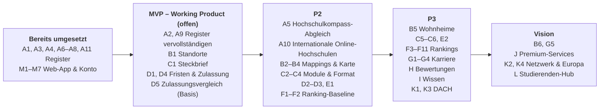

# ProjectPathly – Feature-Katalog

> Orientierungsplattform für Bildung und Karriere
>
> **Stand:** 04.11.2026 · **Grundlage:** zwei Abstimmungen zwischen Karm und Lasse (KI-generierte Besprechungsnotizen, inhaltlich übernommen und strukturiert) sowie der aktuelle Stand des Repositories.
>
> In den Notizen taucht der Produktname teils als „Pawley“ auf – gemeint ist **ProjectPathly**. Die Website läuft unter dem Namen **Pathly** auf [pathly.info](https://pathly.info).
>
> Zahlen zum Register stammen aus den Daten im Repository (`scrapers/hochschulen/data/`, letzter Build 02.10.2026), nicht aus der Live-Datenbank.

---

## Inhalt

1. [Zielbild](#1-zielbild)
2. [Leitprinzipien](#2-leitprinzipien)
3. [Legende](#3-legende)
4. [Übersicht aller Features](#4-übersicht-aller-features)
5. [Feature-Details](#5-feature-details)
   - [A – Hochschul-Register & Datengrundlage](#a--hochschul-register--datengrundlage)
   - [B – Standorte & Kartenansicht](#b--standorte--kartenansicht)
   - [C – Studiengänge](#c--studiengänge)
   - [D – Bewerbung & Zulassung](#d--bewerbung--zulassung)
   - [E – Kosten & Lebenshaltung](#e--kosten--lebenshaltung)
   - [F – Rankings](#f--rankings)
   - [G – Karriere & Outcomes](#g--karriere--outcomes)
   - [H – Studentische Bewertungen & Verifikation](#h--studentische-bewertungen--verifikation)
   - [I – Wissens- & Unterstützungsangebot](#i--wissens---unterstützungsangebot)
   - [J – Bewerbungstraining & Premium-Services](#j--bewerbungstraining--premium-services)
   - [K – Internationalisierung & Netzwerke](#k--internationalisierung--netzwerke)
   - [L – Studierenden-Hub (Vision)](#l--studierenden-hub-vision)
   - [M – Web-App & Konto](#m--web-app--konto)
6. [Roadmap](#6-roadmap)
7. [Datenquellen](#7-datenquellen)
8. [Offene Aufgaben aus den Meetings](#8-offene-aufgaben-aus-den-meetings)
9. [Offene Fragen & Risiken](#9-offene-fragen--risiken)

---

## 1. Zielbild

ProjectPathly soll Studieninteressierten und Studierenden einen **zentralen, transparenten Überblick** über Hochschulen, Studiengänge, Zulassung, Kosten und Karriereperspektiven geben – zunächst für Deutschland, später für den DACH-Raum und Europa.

Langfristig wird aus der Übersichtsplattform ein **Informations- und Unterstützungsangebot** für den gesamten Weg von der Studienwahl über Bewerbung und Studium bis in den Beruf.

**Kern-Mehrwert:**

- Alle relevanten Informationen zu Hochschule und Studiengang an einem Ort statt verstreut auf Hochschulseiten.
- Vergleich von Zulassungsvoraussetzungen, insbesondere beim Übergang Bachelor → Master (Kernfeature).
- Eigene, **nachvollziehbare** Rankings statt unkommentierter Übernahme bestehender Rankings.
- Ehrliche Einordnung von Karrierechancen – ohne Erfolgsversprechen.

---

## 2. Leitprinzipien

| # | Prinzip | Bedeutung für die Umsetzung |
|---|---|---|
| P1 | **Working Product zuerst** | Erst ein funktionsfähiges Kernprodukt, dann Feature-Deep-Dives, Menüstruktur und internationale Erweiterung. |
| P2 | **Offizielle Quellen sind maßgeblich** | Daten stammen bevorzugt aus amtlichen Quellen (Landesministerien). Nichts wird aus Namen „erraten“. Quelle, URL und Abrufzeitpunkt werden pro Datensatz gespeichert. |
| P3 | **Transparente Methodik** | Jede Ranking-Formel, jeder Faktor und jede Gewichtung wird offen dokumentiert. |
| P4 | **Keine Garantien** | Die Plattform gibt keine festen Bildungs- oder Karrierewege vor und verspricht keine Ergebnisse. Aussagen werden **probabilistisch** formuliert („Profile mit X haben typischerweise bessere Chancen auf Y“). |
| P5 | **Kennzahlen immer mit Kontext** | Gehälter und ähnliche KPIs werden nur mit Einordnung gezeigt (Berufserfahrung, vorherige Ausbildung, Jobwechsel, individuelle Ziele). |
| P6 | **Alternative Wege sichtbar machen** | Ungewöhnliche Bildungswege werden nicht ausgeschlossen. Nischenkompetenzen und individuelle Erfahrungen können ebenso zum Ziel führen. |
| P7 | **Verifizierte Stimmen** | Studentische Bewertungen nur nach nachgewiesener Hochschulzugehörigkeit. |

---

## 3. Legende

**Phase**

| Kürzel | Bedeutung |
|---|---|
| **MVP** | Teil des ersten Working Products |
| **P2** | Nächste Ausbaustufe nach dem MVP |
| **P3** | Spätere Ausbaustufe |
| **V** | Langfristige Vision |

**Status**

| Symbol | Bedeutung |
|---|---|
| ✅ | umgesetzt |
| 🟡 | in Arbeit / teilweise umgesetzt |
| ⚪ | offen / Idee |

---

## 4. Übersicht aller Features

| ID | Feature | Phase | Status | Verantwortlich |
|---|---|---|---|---|
| **A** | **Hochschul-Register & Datengrundlage** | | | |
| A1 | Hochschul-Scraper (Name, Website, Bundesland) | MVP | ✅ | Karm |
| A2 | Erweiterte Hochschul-Attribute (Trägerschaft, Typ, Anerkennung) | MVP | 🟡 | Karm |
| A3 | Quellen-Nachverfolgung & Rohdaten-Snapshots | MVP | ✅ | Karm |
| A4 | Deduplizierung & Vereinheitlichung | MVP | ✅ | Karm |
| A5 | Abgleich mit Hochschulkompass (Validierungsreport) | P2 | ⚪ | – |
| A6 | Containerisierter Betrieb (Docker) | MVP | ✅ | Karm |
| A7 | Prüfung & Ermittlung offizieller Websites | MVP | ✅ | Karm |
| A8 | Zuverlässige Läufe & sichere Veröffentlichung | MVP | ✅ | Karm |
| A9 | Physische Präsenz in Deutschland | MVP | 🟡 | Karm |
| A10 | Internationale Online-Hochschulen | P2 | 🟡 | Karm |
| A11 | Scraper-Oberfläche & Datenbank-Import | MVP | ✅ | Karm |
| **B** | **Standorte & Kartenansicht** | | | |
| B1 | Standort-Datenmodell (Haupt- & Nebenstandorte) | MVP | 🟡 | Lasse |
| B2 | Zuordnung Fakultät ↔ Standort | P2 | ⚪ | Lasse |
| B3 | Zuordnung Studiengang ↔ Standort/Gebäude | P2 | ⚪ | Lasse |
| B4 | Kartenansicht Hochschulstandorte | P2 | ⚪ | – |
| B5 | Studentenwohnheime auf der Karte | P3 | ⚪ | – |
| B6 | Weitere Orte auf der Karte (Mensen, relevante POIs) | V | ⚪ | – |
| **C** | **Studiengänge** | | | |
| C1 | Studiengangs-Steckbrief (Dauer, Abschluss, Sprache) | MVP | 🟡 | Lasse |
| C2 | Semesterplan & Module | P2 | ⚪ | – |
| C3 | Modulbeschreibungen | P2 | ⚪ | – |
| C4 | Studienformat (Vollzeit/Teilzeit, Wochentag/Wochenende/Block) | P2 | ⚪ | – |
| C5 | Kohorten-Kennzahlen (Alter, Klassengröße, Gender, International) | P3 | ⚪ | – |
| C6 | Verwendete Programmiersprachen / Tools | P3 | ⚪ | – |
| **D** | **Bewerbung & Zulassung** | | | |
| D1 | Bewerbungszeiträume als Zeitfenster | MVP | ⚪ | – |
| D2 | Early-Bird-Fristen & Rabatte | P2 | ⚪ | – |
| D3 | Checkliste erforderlicher Unterlagen | P2 | ⚪ | – |
| D4 | Zulassungsvoraussetzungen (ECTS, Pflichtfächer) | MVP | 🟡 | Lasse |
| D5 | **Bachelor-Master-Zulassungsvergleich (Kernfeature)** | MVP/P2 | 🟡 | Lasse |
| **E** | **Kosten & Lebenshaltung** | | | |
| E1 | Studiengebühren (Semester / gesamt) | P2 | ⚪ | – |
| E2 | Kontextbezogene Kostenprognose | P3 | ⚪ | – |
| **F** | **Rankings** | | | |
| F1 | Ranking-Framework & offene Methodik | P2 | ⚪ | Karm, Lasse |
| F2 | Einkommen & Karrierechancen | P2 | ⚪ | Karm |
| F3 | Innovation & Zukunftssicherheit | P3 | ⚪ | Karm |
| F4 | Praxis- vs. Forschungsorientierung | P3 | ⚪ | Lasse |
| F5 | Wissenschaftliche Qualität | P3 | ⚪ | – |
| F6 | Industriebezug | P3 | ⚪ | Lasse |
| F7 | Entrepreneurship | P3 | ⚪ | – |
| F8 | Fachspezifische Rankings (z. B. BWL) | P3 | ⚪ | – |
| F9 | Facility-Ranking | P3 | ⚪ | – |
| F10 | Standort-Rankings (einzeln & kumuliert) | P3 | ⚪ | – |
| F11 | Gesamtranking (kumuliert) | P3 | ⚪ | Karm, Lasse |
| **G** | **Karriere & Outcomes** | | | |
| G1 | Karrierepfade & Absolventen-Positionierung | P3 | ⚪ | – |
| G2 | Gehalts-KPIs mit Kontext | P3 | ⚪ | Karm |
| G3 | ROI-Einschätzung für Masterprogramme | P3 | ⚪ | – |
| G4 | Praktika-Analyse & Einstiegspfade | P3 | ⚪ | Karm |
| G5 | Probabilistische Profil-Orientierung | V | ⚪ | – |
| **H** | **Studentische Bewertungen & Verifikation** | | | |
| H1 | Verifikation über Hochschul-Mailadresse | P3 | ⚪ | Karm |
| H2 | Studentische Bewertungen (internes Ranking) | P3 | ⚪ | – |
| **I** | **Wissens- & Unterstützungsangebot** | | | |
| I1 | Bewerbungs-Grundlagen (CV, Anschreiben, Interviews) | P3 | ⚪ | – |
| I2 | Studium-Grundlagen (Lernen, Prüfungen, Administration) | P3 | ⚪ | – |
| I3 | Studienplanung (Double Degree, Praktikumsfenster) | P3 | ⚪ | – |
| **J** | **Bewerbungstraining & Premium-Services** | | | |
| J1 | KI-Sprachchatbot als Bewerbungs-Sparringspartner | V | ⚪ | – |
| J2 | Case-Study- & Quant-Simulationen | V | ⚪ | – |
| J3 | CV-Check-Service | V | ⚪ | – |
| **K** | **Internationalisierung & Netzwerke** | | | |
| K1 | Auslandssemester & Partnerhochschulen | P3 | ⚪ | – |
| K2 | Netzwerk-/Graph-Ansicht (Hochschulen, Verbände, Unternehmen) | V | ⚪ | – |
| K3 | Regionaler Ausbau DACH | P3 | ⚪ | – |
| K4 | Regionaler Ausbau Europa | V | ⚪ | – |
| **L** | **Studierenden-Hub (Vision)** | | | |
| L1 | Hochschulkonto verbinden & Stundenplan laden | V | ⚪ | – |
| L2 | Mensa-Finder & aktueller Speiseplan | V | ⚪ | – |
| **M** | **Web-App & Konto** | | | |
| M1 | Startseite mit Suche und Ausblick „Was kommt“ | MVP | ✅ | Lasse |
| M2 | Hochschulsuche mit Filtern | MVP | ✅ | Lasse |
| M3 | Hochschul-Detailseite | MVP | ✅ | Lasse |
| M4 | Deutschlandkarte als Einstieg (Bundesländer) | MVP | ✅ | Lasse |
| M5 | Registrierung, Login & Kontoverwaltung | MVP | ✅ | Lasse |
| M6 | Impressum & Datenschutz | MVP | ✅ | Lasse |
| M7 | Suchmaschinen-Grundlagen & Web Analytics | MVP | ✅ | Lasse |
| M8 | Merkliste | P2 | 🟡 | Lasse |

---

## 5. Feature-Details

### A – Hochschul-Register & Datengrundlage

Fundament der Plattform: ein reproduzierbares Verzeichnis aller deutschen Hochschulen, aufgebaut aus offiziellen Quellen der Bundesländer. Umgesetzt im Modul [`scrapers/hochschulen`](../scrapers/hochschulen/README.md).

#### A1 – Hochschul-Scraper (Grunddaten)

| | |
|---|---|
| **Phase / Status** | MVP · ✅ |
| **Verantwortlich** | Karm |
| **Beschreibung** | Erfasst für jede Hochschule die Pflichtfelder **Name** und **offizielle Website** sowie – sofern die Quelle es liefert – das **meldende Bundesland**. |
| **Datenfelder** | `name`, `official_url`, `state` (ISO 3166-2, z. B. `DE-NW`), `country` |
| **Aktueller Stand** | Alle 16 Bundesländer laufen erfolgreich durch (`build_status: complete`), das Saarland über das Ausbildungsstättenverzeichnis (PDF). Der Master enthält 435 deutsche Einträge, 431 davon sind öffentlich sichtbar. |
| **Akzeptanzkriterien** | Für jedes Bundesland mindestens Name + Website aller gelisteten Hochschulen; Lauf ist reproduzierbar (`python -m registry.run`). |

#### A2 – Erweiterte Hochschul-Attribute

| | |
|---|---|
| **Phase / Status** | MVP · 🟡 |
| **Beschreibung** | Ergänzung von Attributen, abhängig davon, was die jeweilige Landesquelle bereitstellt. |
| **Datenfelder** | `ownership` (öffentlich / privat / kirchlich), `institution_type` (Universität, HAW, Kunst-/Musikhochschule, PH, Duale Hochschule …), `recognition_status` |
| **Regel** | Werte nur übernehmen, wenn die Quelle sie explizit nennt – sonst `unknown`. |
| **Aktueller Stand** | Von allen 505 Einträgen (inkl. internationaler Kandidaten) sind `institution_type` bei 74, `ownership` bei 125 und `recognition_status` bei 446 noch `unknown`. Der Anerkennungsstatus ist damit die größte Lücke. |

#### A3 – Quellen-Nachverfolgung & Rohdaten-Snapshots

| | |
|---|---|
| **Phase / Status** | MVP · ✅ |
| **Beschreibung** | Jeder Abruf wird als Rohdatei gespeichert (`data/raw/`, `data/source_cache/`). Jeder Datensatz trägt Behörde, URL, Quelltyp (HTML/CSV/PDF) und Abrufzeitpunkt. |
| **Datenfelder** | `source.authority`, `source.url`, `source.source_type`, `source.retrieved_at` |
| **Nutzen** | Nachvollziehbarkeit (P2, P3), Debugging, spätere Änderungsverfolgung. |

#### A4 – Deduplizierung & Vereinheitlichung

| | |
|---|---|
| **Phase / Status** | MVP · ✅ (in `main`) |
| **Beschreibung** | Zusammenführen doppelter Einträge (z. B. Hochschule in mehreren Landeslisten) und Normalisierung von Schreibweisen, Typen und URLs. Unklare Fälle werden in `data/master/overrides.yaml` entschieden. Jede Hochschule behält eine dauerhafte ID. |

#### A5 – Abgleich mit Hochschulkompass

| | |
|---|---|
| **Phase / Status** | P2 · ⚪ |
| **Beschreibung** | Vergleich des eigenen Registers mit dem Hochschulkompass der HRK als **Validierungsreport** (`MATCH`, `MISSING`, `CONFLICT`) – kein stilles Überschreiben. |

#### A6 – Containerisierter Betrieb

| | |
|---|---|
| **Phase / Status** | MVP · ✅ |
| **Beschreibung** | Scraper läuft per `Dockerfile` / `docker-compose.yml` reproduzierbar auf jeder Maschine. |

#### A7 – Prüfung & Ermittlung offizieller Websites

| | |
|---|---|
| **Phase / Status** | MVP · ✅ |
| **Beschreibung** | Website-URLs werden technisch geprüft, fehlende über Domain-Kandidaten gesucht. Als letztes Mittel schlägt ein KI-Agent mit Websuche eine Adresse vor, die dieselben Prüfungen bestehen muss. Akzeptiert wird nur, wenn das Impressum die Hochschule nennt; sonst bleibt der Fall in Prüfung. |
| **Aktueller Stand** | 498 von 505 Einträgen haben eine verifizierte Website. |

#### A8 – Zuverlässige Läufe & sichere Veröffentlichung

| | |
|---|---|
| **Phase / Status** | MVP · ✅ |
| **Beschreibung** | Wiederholte Abrufe bei Quellenfehlern und Warnung bei auffälligen Änderungen der Anzahl je Bundesland. Ist ein Build nicht sicher, werden die veröffentlichten Dateien nicht ersetzt. |

#### A9 – Physische Präsenz in Deutschland

| | |
|---|---|
| **Phase / Status** | MVP · 🟡 |
| **Beschreibung** | Bewertet, ob eine Hochschule aktuell mindestens einen aktiven Standort in Deutschland hat. „Nicht präsent“ gilt nur nach manueller Prüfung mit Beleg. Öffentlich sichtbar sind nur Hochschulen mit bestätigtem Zugang (`market_access`). |
| **Aktueller Stand** | 431 von 435 deutschen Einträgen sind bestätigt, die übrigen in Prüfung. Die Einstufung ist vorläufig und soll durch einen späteren Scraper mit Standortdaten von den Hochschul-Websites bestätigt oder korrigiert werden. |

#### A10 – Internationale Online-Hochschulen

| | |
|---|---|
| **Phase / Status** | P2 · 🟡 |
| **Beschreibung** | Hochschulen außerhalb Deutschlands, die einen vollständigen Online-Abschluss anbieten und aus Deutschland zugänglich sind. Kandidaten kommen aus ETER (Europa) und IPEDS (USA). Details: [Quellenkonzept v1.3](hochschulregister-v1.3-internationale-quellen.md). |
| **Regel** | Öffentlich erst nach manueller Entscheidung mit zwei offiziellen Belegen: Online-Abschluss und Einschreibung aus Deutschland. |
| **Aktueller Stand** | 70 Kandidaten sind erfasst, alle noch in Prüfung und damit nicht öffentlich sichtbar. |
| **Abgrenzung** | Kein regionaler Ausbau im Sinne von K3/K4. Hier geht es nur um Angebote, die aus Deutschland studierbar sind. |

#### A11 – Scraper-Oberfläche & Datenbank-Import

| | |
|---|---|
| **Phase / Status** | MVP · ✅ |
| **Beschreibung** | Weboberfläche zum Steuern der Scraper und zum Entscheiden von Prüffällen ([`apps/scraper-ui`](../apps/scraper-ui/README.md)). Der Import nach Supabase ist wiederholbar und löscht keine Hochschulen; nicht mehr gelistete werden nur markiert. |

---

### B – Standorte & Kartenansicht

#### B1 – Standort-Datenmodell

| | |
|---|---|
| **Phase / Status** | MVP · 🟡 |
| **Verantwortlich** | Lasse (Definition des vollständigen Datensatzes) |
| **Beschreibung** | Hochschule und Standort sind getrennte Entitäten. Eine Hochschule hat einen Hauptstandort und beliebig viele Nebenstandorte/Campus. |
| **Datenfelder** | `locations[].name` (Bezeichnung, z. B. „Campus Garching“), `street`, `postal_code`, `city`, `location_type` (`main` / `branch`), `latitude`, `longitude` |
| **Aktueller Stand** | Das Schema steht. Erfasst sind 322 Standorte für 229 der 505 Einträge (207 Haupt-, 115 Nebenstandorte), davon 197 mit Straße und 87 mit Bezeichnung. Die Spalten für Geokoordinaten gibt es in der Datenbank, die Pipeline befüllt sie aber noch nicht. |

#### B2 – Zuordnung Fakultät ↔ Standort

| | |
|---|---|
| **Phase / Status** | P2 · ⚪ |
| **Beschreibung** | Welche Fakultäten/Fachbereiche sitzen an welchem Standort. |

#### B3 – Zuordnung Studiengang ↔ Standort/Gebäude

| | |
|---|---|
| **Phase / Status** | P2 · ⚪ |
| **Beschreibung** | Mapping, an welchem Standort bzw. in welchem Gebäude ein Studiengang stattfindet. Grundlage für Kartenansicht, Wege- und Wohnortplanung. |
| **Abhängigkeiten** | B1, C1 |

#### B4 – Kartenansicht Hochschulstandorte

| | |
|---|---|
| **Phase / Status** | P2 · ⚪ |
| **Beschreibung** | Interaktive Karte aller Hochschulstandorte mit Filter (Bundesland, Typ, Trägerschaft, Studiengang). Klick auf Standort öffnet Hochschul- bzw. Studiengangs-Steckbrief. |
| **Abhängigkeiten** | B1 inkl. Geokoordinaten (Geocoding der Adressen) |
| **Abgrenzung** | Die Karte auf der Startseite (M4) zeigt nur Bundesländer, keine einzelnen Standorte. |

#### B5 – Studentenwohnheime auf der Karte

| | |
|---|---|
| **Phase / Status** | P3 · ⚪ |
| **Beschreibung** | Staatliche Studentenwohnheime (Studierendenwerke) als eigene Kartenebene, damit Studierende Wege und Wohnort rund um das Studium planen können. Optional: Mietpreise als Input für E2. |

#### B6 – Weitere Orte auf der Karte

| | |
|---|---|
| **Phase / Status** | V · ⚪ |
| **Beschreibung** | Zusätzliche Ebenen wie Mensen, Bibliotheken oder andere studienrelevante Orte. |

---

### C – Studiengänge

#### C1 – Studiengangs-Steckbrief

| | |
|---|---|
| **Phase / Status** | MVP · ⚪ |
| **Beschreibung** | Kerninformationen je Studiengang (Bachelor und Master). |
| **Datenfelder** | Name, Abschluss (B.Sc., M.A., …), Regelstudienzeit, ECTS gesamt, Unterrichtssprache(n), Hochschule, Standort(e), Studienbeginn (WS/SS), Link zur Studiengangsseite |
| **Aktueller Stand** | Tabelle `programs` und Seiten `/studiengaenge` stehen, aber nur auf dem Dev-Server und mit erfundenen Demodaten (`supabase/seeds/dev-demo-programs.sql`). Auf pathly.info sind sie verborgen (`lib/flags.ts`). Es gibt noch keinen Scraper, die Datenquelle ist rechtlich nicht geklärt (Abschnitt 9). |

#### C2 – Semesterplan & Module

| | |
|---|---|
| **Phase / Status** | P2 · ⚪ |
| **Beschreibung** | Darstellung des Studienverlaufs pro Semester mit Pflicht- und Wahlmodulen sowie ECTS je Modul. |

#### C3 – Modulbeschreibungen

| | |
|---|---|
| **Phase / Status** | P2 · ⚪ |
| **Beschreibung** | Inhalte und Anforderungen einzelner Module (aus Modulhandbüchern), damit Interessierte Inhalte und Schwierigkeit besser einschätzen können. Grundlage für die Innovationsmetrik (F3). |

#### C4 – Studienformat

| | |
|---|---|
| **Phase / Status** | P2 · ⚪ |
| **Beschreibung** | Vollzeit, Teilzeit, dual, berufsbegleitend. Bei Teilzeit: Veranstaltungen **unter der Woche, am Wochenende oder in Blöcken** – wichtig für die Abstimmung mit Arbeitgebern. |

#### C5 – Kohorten-Kennzahlen

| | |
|---|---|
| **Phase / Status** | P3 · ⚪ |
| **Beschreibung** | Altersdurchschnitt, Klassen-/Kohortengröße, Geschlechterverteilung, Anteil internationaler Studierender. |

#### C6 – Programmiersprachen & Tools

| | |
|---|---|
| **Phase / Status** | P3 · ⚪ |
| **Beschreibung** | Welche Programmiersprachen und Tools im Studiengang gelehrt bzw. genutzt werden (z. B. Python, R, SQL, MATLAB). |

---

### D – Bewerbung & Zulassung

#### D1 – Bewerbungszeiträume

| | |
|---|---|
| **Phase / Status** | MVP · ⚪ |
| **Beschreibung** | Bewerbungsfristen als klar erkennbare Zeitfenster (Start, Ende, ggf. mehrere Runden), getrennt nach Semester sowie nach deutschen/internationalen Bewerbenden. |
| **Erweiterung** | Erinnerungsfunktion / Kalender-Export (P2). |

#### D2 – Early-Bird-Fristen & Rabatte

| | |
|---|---|
| **Phase / Status** | P2 · ⚪ |
| **Beschreibung** | Bei kostenpflichtigen Studiengängen: Early-Bird-Deadlines und die damit verbundenen Rabatte. |

#### D3 – Checkliste Unterlagen

| | |
|---|---|
| **Phase / Status** | P2 · ⚪ |
| **Beschreibung** | Übersicht der benötigten Unterlagen, z. B. Lebenslauf, Transcript of Records, Empfehlungsschreiben, Motivationsschreiben, Sprachnachweise, GMAT/GRE. |

#### D4 – Zulassungsvoraussetzungen

| | |
|---|---|
| **Phase / Status** | MVP · ⚪ |
| **Beschreibung** | Strukturierte Erfassung: erforderlicher Abschluss, Mindest-ECTS, ECTS in bestimmten Fachgebieten, Pflichtfächer, Notengrenzen/NC, Sprachniveau. |

#### D5 – Bachelor-Master-Zulassungsvergleich ⭐ Kernfeature

| | |
|---|---|
| **Phase / Status** | MVP/P2 · ⚪ |
| **Beschreibung** | Nutzer gibt seinen Bachelor (bzw. Module/ECTS) an und sieht, für welche Master er die Zulassungsvoraussetzungen erfüllt, teilweise erfüllt (inkl. fehlender ECTS/Fächer) oder nicht erfüllt. |
| **Abhängigkeiten** | C1, C2, D4 |
| **Hinweis** | Von Karm als besonders wichtig eingestuft. Laut Lasse aber erst nach einem funktionsfähigen Grundprodukt im Detail ausarbeiten. |
| **Aktueller Stand** | Erster Entwurf auf dem Dev-Server: Hochschule und Bachelor-Studiengang genügen, Fachrichtung und ECTS kommen aus dem Studienplan (`programs.curriculum_ects`), die Note ist optional. Der Abgleich läuft im Browser (`lib/admission.ts`, Tests mit `npm test`), das Profil bleibt auf dem Gerät. Die Grenzen für „teilweise erfüllt“ (30 ECTS, 0,3 Notenpunkte, die Hälfte der Fachgebiets-ECTS) sind Annahmen und müssen mit echten Prüfungsordnungen geprüft werden. |

---

### E – Kosten & Lebenshaltung

#### E1 – Studiengebühren

| | |
|---|---|
| **Phase / Status** | P2 · ⚪ |
| **Beschreibung** | Semesterbeitrag, Studiengebühren pro Semester bzw. Gesamtkosten des Programms. |

#### E2 – Kontextbezogene Kostenprognose

| | |
|---|---|
| **Phase / Status** | P3 · ⚪ |
| **Beschreibung** | Schätzung der Gesamtkosten des Studiums: Gebühren + monatliche Lebenshaltung (Miete, Essen) am Studienort, optional Wohnheimkosten (B5). |
| **Darstellung** | Als Spanne mit Annahmen, nicht als exakter Wert. |

---

### F – Rankings

**Grundsatz:** eigene, transparente, datenbasierte Rankings statt unveränderter Übernahme bestehender Rankings. Einzelrankings sind individuell einsehbar und werden zu einem Gesamtranking kumuliert. Ausreißer einzelner Metriken schwächen sich über mehrere Dimensionen ab.

**Orientierung an etablierten Rankings** (z. B. Financial Times): Umfragen, Reputation, Forschungsleistung sowie statistische Kennzahlen wie Betreuungsverhältnis, finanzielle Ausstattung, Anteil internationaler Studierender und Zitationsmaße.

#### F1 – Ranking-Framework & offene Methodik

| | |
|---|---|
| **Phase / Status** | P2 · ⚪ |
| **Verantwortlich** | Karm, Lasse |
| **Beschreibung** | Technisches und methodisches Gerüst: Dimensionen, Metriken, Normalisierung, Gewichtung, Aggregation. Öffentliche Methodik-Seite je Ranking. |
| **Anforderungen** | Jeder Faktor dokumentiert · Datenquelle und Stand angegeben · Gewichtung sichtbar (optional vom Nutzer anpassbar) · Versionierung der Methodik |

#### F2 – Einkommen & Karrierechancen

| | |
|---|---|
| **Phase / Status** | P2 · ⚪ |
| **Beschreibung** | Baseline-Ranking auf Basis von Absolventen-Daten: Median-/Durchschnittsgehälter, Arbeitgeber ehemaliger Studierender, Platzierung bei Top-Unternehmen, möglichst je Studiengang. |
| **Mögliche Quelle** | LinkedIn (Jobs/Profile), weitere zu prüfen |
| **Pflicht-Hinweis** | Hohe Einkommenswerte ≠ „beste Hochschule“. Gehälter werden durch Berufserfahrung, vorherige Ausbildung und Jobwechsel verzerrt (P5). |

#### F3 – Innovation & Zukunftssicherheit

| | |
|---|---|
| **Phase / Status** | P3 · ⚪ |
| **Beschreibung** | Wie stark decken Studiengänge aktuelle gesellschaftliche und wirtschaftliche Themen ab und wie zukunftssicher sind die daraus folgenden Berufsperspektiven? |
| **Metriken (Ideen)** | Abdeckung von Themen wie Digitalisierung, KI, Quantencomputing, Globalisierung/Handel in Modulen (C3) · digitale Kompetenzen · englischsprachige Anteile/Internationalität |
| **Beispiel** | Ein rein deutschsprachiger BWL-Studiengang ohne digitale oder englische Bezüge schneidet in einer globalen Wirtschaft schlechter ab. |
| **Später** | Fachinterviews mit Führungskräften/Unternehmen zu gesuchten Skills. |

#### F4 – Praxis- vs. Forschungsorientierung

| | |
|---|---|
| **Phase / Status** | P3 · ⚪ |
| **Beschreibung** | Einordnung auf einer Skala zwischen starkem Praxisbezug (Praxissemester, Projekte mit Unternehmen, Dozierende aus der Praxis) und ausgeprägtem Forschungsauftrag. Eher Profil als Rangfolge. |

#### F5 – Wissenschaftliche Qualität

| | |
|---|---|
| **Phase / Status** | P3 · ⚪ |
| **Metriken (Ideen)** | Anzahl Publikationen der Hochschule und ihrer Professor:innen, Zitationsmaße, Drittmittel. Abhängig von verlässlichen Quellen. |

#### F6 – Industriebezug

| | |
|---|---|
| **Phase / Status** | P3 · ⚪ |
| **Beschreibung** | Welche Branchen eine Hochschule besonders stark bedient (z. B. Automobilindustrie), etwa über Absolventen-Arbeitgeber, Kooperationen, Stiftungsprofessuren. |

#### F7 – Entrepreneurship

| | |
|---|---|
| **Phase / Status** | P3 · ⚪ |
| **Metriken (Ideen)** | Ausgründungen, Gründungszentren/Inkubatoren, Gründungen durch Absolvent:innen, Entrepreneurship-Module. |

#### F8 – Fachspezifische Rankings

| | |
|---|---|
| **Phase / Status** | P3 · ⚪ |
| **Beschreibung** | Rankings pro Fachrichtung, z. B. BWL. |

#### F9 – Facility-Ranking

| | |
|---|---|
| **Phase / Status** | P3 · ⚪ |
| **Beschreibung** | Qualität und Ausstattung der Einrichtungen (Bibliotheken, Labore, Lernräume, Sport, Mensa). Bei mehreren Standorten pro Standort bewertet. |

#### F10 – Standort-Rankings

| | |
|---|---|
| **Phase / Status** | P3 · ⚪ |
| **Beschreibung** | Standorte einer Hochschule einzeln bewerten und bei Bedarf kumulieren, damit Unterschiede zwischen Campus sichtbar werden. |

#### F11 – Gesamtranking

| | |
|---|---|
| **Phase / Status** | P3 · ⚪ |
| **Beschreibung** | Gewichtete Kumulation der Einzelrankings F2–F10. Gewichtung transparent, optional durch Nutzer individualisierbar („Was ist mir wichtig?“). |

---

### G – Karriere & Outcomes

#### G1 – Karrierepfade & Absolventen-Positionierung

| | |
|---|---|
| **Phase / Status** | P3 · ⚪ |
| **Beschreibung** | Typische Karrierepfade nach einem Studiengang, z. B. Consulting, Finance, Investment Banking, Industrie, und wo Absolvent:innen landen. |

#### G2 – Gehalts-KPIs mit Kontext

| | |
|---|---|
| **Phase / Status** | P3 · ⚪ |
| **Beschreibung** | Durchschnitts-/Mediangehälter je Studiengang bzw. Karrierepfad, immer mit Einordnung (Berufserfahrung, Branche, Region, Stichprobengröße). Keine Suggestion eines garantierten Weges (P4, P5). |

#### G3 – ROI-Einschätzung Master

| | |
|---|---|
| **Phase / Status** | P3 · ⚪ |
| **Beschreibung** | Hilft ein bestimmter Master beruflich weiter? Kosten (E1/E2) im Verhältnis zu Karriere- und Gehaltseffekten (G1/G2). |

#### G4 – Praktika-Analyse & Einstiegspfade

| | |
|---|---|
| **Phase / Status** | P3 · ⚪ |
| **Beschreibung** | Auswertung öffentlich verfügbarer Profile von Mitarbeitenden z. B. bei BCG, McKinsey, Bain: durchschnittliche Anzahl Praktika und typische Einstiegspfade. |
| **Botschaft** | Karrierewege entstehen schrittweise – nicht jedes erste Praktikum muss bei einem Top-Arbeitgeber stattfinden. |
| **Hinweis** | Rechtliche Prüfung (Datenschutz, Nutzungsbedingungen der Plattformen) erforderlich. |

#### G5 – Probabilistische Profil-Orientierung

| | |
|---|---|
| **Phase / Status** | V · ⚪ |
| **Beschreibung** | Einordnung, welche Profile typischerweise bessere Chancen für bestimmte Ziele haben – unter Berücksichtigung von relevanten Praktika, Ehrenamt, besonderen Fachkenntnissen, Leistungen und Gründungserfahrung. Ausdrücklich ohne Zusage, alternative Wege bleiben sichtbar (P4, P6). |

---

### H – Studentische Bewertungen & Verifikation

#### H1 – Verifikation über Hochschul-Mailadresse

| | |
|---|---|
| **Phase / Status** | P3 · ⚪ |
| **Verantwortlich** | Karm (Konzept) |
| **Beschreibung** | Bewertungen nur nach Registrierung mit einer Hochschul-Mailadresse (Domain-Abgleich mit `official_url` aus A1 + Bestätigungslink). Schützt vor externen oder unbelegten Abwertungen. |
| **Offene Punkte** | Umgang mit Alumni (Mailadresse läuft ab), Mehrfach-Accounts, Domains von Tochter-/Partnereinrichtungen, Datenschutz (DSGVO). |

#### H2 – Studentische Bewertungen

| | |
|---|---|
| **Phase / Status** | P3 · ⚪ |
| **Beschreibung** | Verifizierte Studierende bewerten Aspekte des Hochschulalltags (z. B. Lehre, Betreuung, Organisation, Ausstattung, Campusleben). Ergebnis ist ein **internes Ranking durch Studierende**, klar getrennt vom plattformseitigen, datenbasierten Ranking (F). |

---

### I – Wissens- & Unterstützungsangebot

Gebündelte Antworten auf Grundsatzfragen, besonders zu Beginn eines Bachelor- oder Masterstudiums.

| ID | Feature | Phase | Inhalte |
|---|---|---|---|
| I1 | Bewerbungs-Grundlagen | P3 | Lebenslauf, Anschreiben, Bewerbungsgespräche |
| I2 | Studium-Grundlagen | P3 | Lernmethoden, Prüfungsphasen, administrative Abläufe (Einschreibung, Rückmeldung, Prüfungsanmeldung) |
| I3 | Studienplanung | P3 | Wie funktionieren Double Degrees? Wie holt man mehr aus dem Studium heraus? Wann Praktika einplanen? Feste Praktikafenster früh verstehen, damit Bewerbungen rechtzeitig erfolgen. |

---

### J – Bewerbungstraining & Premium-Services

Mögliches Monetarisierungsfeld: kostenpflichtige bzw. teilweise kostenlose Zusatzleistungen.

#### J1 – KI-Sprachchatbot als Bewerbungs-Sparringspartner

| | |
|---|---|
| **Phase / Status** | V · ⚪ |
| **Beschreibung** | Animierter KI-Sprachchatbot, mit dem Demo-Bewerbungsgespräche geführt werden können, inkl. Feedback. |

#### J2 – Case-Study- & Quant-Simulationen

| | |
|---|---|
| **Phase / Status** | V · ⚪ |
| **Beschreibung** | Spezielle Simulationen für Case Studies (Consulting), Mathematik und quantitative Studiengänge. |

#### J3 – CV-Check-Service

| | |
|---|---|
| **Phase / Status** | V · ⚪ |
| **Beschreibung** | Upload des Lebenslaufs als PDF. Rückgabe mit manuellen bzw. personalisierten, handschriftähnlichen Kommentaren. |
| **Serviceversprechen** | Rückgabe innerhalb weniger Stunden (im Meeting genannt: ca. 6–12 h). |

---

### K – Internationalisierung & Netzwerke

#### K1 – Auslandssemester & Partnerhochschulen

| | |
|---|---|
| **Phase / Status** | P3 · ⚪ |
| **Beschreibung** | In welchen Semestern ein Auslandsaufenthalt möglich ist und welche Partnerhochschulen zur Verfügung stehen. Gemeinsame Übersicht über Partnerschaften, die oft über schwer überschaubare Verbände organisiert sind. |
| **Abgrenzung** | Keine Konkurrenz zu spezialisierten Freemover-Plattformen. |

#### K2 – Netzwerk-/Graph-Ansicht

| | |
|---|---|
| **Phase / Status** | V · ⚪ |
| **Beschreibung** | Graph- bzw. Spinnennetz-Darstellung der Verbindungen zwischen Hochschulen, Verbänden und ggf. Unternehmen. Klick auf eine Hochschule zeigt deren externe Partnerschaften und institutionelle Netzwerke. |

#### K3 – Regionaler Ausbau DACH

| | |
|---|---|
| **Phase / Status** | P3 · ⚪ |
| **Beschreibung** | Erweiterung um Österreich und Schweiz, die vergleichsweise gut an das deutsche System anschließen. Erfordert neue Quell-Adapter (analog A1). |

#### K4 – Regionaler Ausbau Europa

| | |
|---|---|
| **Phase / Status** | V · ⚪ |
| **Beschreibung** | Ausweitung auf Europa. Deutlich höhere Komplexität durch unterschiedliche Arbeitsmärkte, Bildungssysteme und Informationsquellen. |

---

### L – Studierenden-Hub (Vision)

Langfristig: zentrale Plattform für mehrere Hochschulen, die auch im laufenden Studium genutzt wird.

| ID | Feature | Phase | Beschreibung |
|---|---|---|---|
| L1 | Hochschulkonto verbinden & Stundenplan laden | V | Studierende verbinden ihre Hochschule und importieren ihren Stundenplan. |
| L2 | Mensa-Finder & Speiseplan | V | Mensen in der Nähe finden und das aktuelle Mensaangebot einsehen. |

---

### M – Web-App & Konto

Die öffentliche Website auf [pathly.info](https://pathly.info), umgesetzt in [`apps/web`](../apps/web/README.md). Das Erscheinungsbild ist in der [Brand Identity](brand-identity.md) beschrieben.

| ID | Feature | Phase | Status | Beschreibung |
|---|---|---|---|---|
| M1 | Startseite | MVP | ✅ | Einstieg mit Suche, Anzahl der Hochschulen, Ausblick „Was kommt“ und Prinzipien. |
| M2 | Hochschulsuche | MVP | ✅ | Suche nach Name, Mehrfachfilter für Art, Trägerschaft und Bundesland, seitenweise Ergebnisse. |
| M3 | Hochschul-Detailseite | MVP | ✅ | Grunddaten, offizielle Website, Standorte und Quellen mit Abrufdatum. |
| M4 | Deutschlandkarte | MVP | ✅ | Interaktive Karte der Bundesländer mit Anzahl der Hochschulen. Ein Klick öffnet die Suche mit diesem Filter. |
| M5 | Registrierung, Login & Konto | MVP | ✅ | Supabase Auth mit E-Mail/Passwort und Google, Passwort zurücksetzen und ändern, Konto selbst löschen. |
| M6 | Impressum & Datenschutz | MVP | ✅ | Rechtsseiten mit Anbieterangaben. |
| M7 | Suchmaschinen-Grundlagen & Analytics | MVP | ✅ | Sitemap, `robots`, Vorschaubild für geteilte Links, Vercel Web Analytics. |
| M8 | Merkliste | P2 | 🟡 | Hochschulen in der Suche und auf der Detailseite merken, Liste unter „Mein Konto“. Gebaut, die Migration muss noch in die Live-Datenbank. |

Auf dem Konto können außerdem zum Beispiel Fristen-Erinnerungen (D1) und die Verifikation für Bewertungen (H1) aufbauen.

---

## 6. Roadmap

**Definition „Working Product“ (Vorschlag):** Ein Nutzer kann eine deutsche Hochschule suchen, sieht deren Grunddaten und Standorte, findet die angebotenen Studiengänge mit Steckbrief, Bewerbungsfristen und Zulassungsvoraussetzungen.

**Stand:** Suche und Grunddaten sind live, Standorte nur teilweise. Es fehlen vor allem die Studiengänge mit Fristen und Zulassungsvoraussetzungen (C1, D1, D4).

---

## 7. Datenquellen

| Quelle | Inhalt | Genutzt für | Status |
|---|---|---|---|
| Landesministerien / amtliche Hochschullisten (16 Bundesländer) | Hochschulen, Typ, Trägerschaft, Adressen | A1–A4, B1 | in Nutzung |
| Ausbildungsstättenverzeichnis Saarland (PDF) | Hochschulen Saarland | A1 | in Nutzung |
| ETER (Europa) | Kandidaten für Online-Hochschulen | A10 | in Nutzung |
| IPEDS (USA) | Kandidaten für Online-Hochschulen | A10 | in Nutzung |
| Hochschulkompass (HRK) | Hochschulen, Studiengänge | A5, C1, D1, D4 | zu prüfen |
| Hochschul-Websites, Modulhandbücher, Prüfungsordnungen | Studiengänge, Module, Zulassung, Fristen | C1–C4, D1–D4, F3 | zu prüfen |
| Studierendenwerke | Wohnheime, Mensen, Semesterbeitrag | B5, E1, L2 | zu prüfen |
| LinkedIn (Jobs/Profile) | Arbeitgeber, Karrierepfade, Gehälter | F2, F6, G1–G4 | zu prüfen (rechtlich!) |
| Publikations-/Zitationsdatenbanken (z. B. OpenAlex) | Publikationen, Zitationen | F5 | zu prüfen |
| Statistisches Bundesamt (Destatis) | Studierendenzahlen, Betreuungsverhältnis, Finanzen | C5, F | zu prüfen |
| Etablierte Rankings (z. B. Financial Times) | Methodik als Orientierung | F1 | Referenz |

---

## 8. Offene Aufgaben aus den Meetings

Der Status „offen“ heißt: Im Repository ist kein Ergebnis zu finden. Arbeit außerhalb des Repositories kann es trotzdem geben.

| Aufgabe | Verantwortlich | Bezug | Status |
|---|---|---|---|
| Pflichtfelder der ersten Scraper-Version festlegen: Name, Website, Bundesland (sofern verfügbar) | Karm | A1 | ✅ |
| Saarland-Daten vollständig durchlesen und PDF parsen | Karm | A1 | ✅ |
| Code-Änderungen als Pull Request bereitstellen | Karm | A4 | ✅ (in `main`, zuletzt Scraper v1.3) |
| Vollständigen Standort-Datensatz definieren (Haupt-/Nebenstandorte, Adressen, Bezeichnungen, Fakultäten, Studiengang-Mapping) | Lasse | B1–B3 | 🟡 Schema für Standorte steht, Fakultäten und Studiengang-Mapping fehlen |
| Belastbare Datenquellen für Gehälter und weitere Ranking-Metriken prüfen | Karm | F2, G2, Abschnitt 7 | ⚪ offen |
| Transparente Ranking-Formel mit getrennten Dimensionen erstellen | Karm, Lasse | F1–F11 | ⚪ offen |
| Verifikationskonzept für Studentenbewertungen (Hochschul-Mail) | Karm | H1 | ⚪ offen |
| Working Product auf Kernfunktionen fokussieren; Feature-Deep-Dive und Internationalisierung verschieben | Lasse, Karm | Abschnitt 6 | 🟡 läuft |

**Neu aus dem Abgleich mit dem Repository (noch ohne Verantwortliche):**

| Aufgabe | Bezug |
|---|---|
| Studiengangs-Scraper und Datenmodell für Studiengänge beginnen | C1, D1, D4 |
| Offene Prüffälle entscheiden: 70 internationale Kandidaten und 4 deutsche Einträge | A9, A10 |
| Standortdaten vervollständigen und Adressen geokodieren | B1, B4 |
| Anerkennungsstatus aus belastbarer Quelle ergänzen | A2 |
| Festlegen, wie oft das Register neu gebaut und importiert wird | Abschnitt 9 |

---

## 9. Offene Fragen & Risiken

| Thema | Frage / Risiko |
|---|---|
| **Rechtliches Scraping** | Nutzungsbedingungen von LinkedIn & Co. verbieten automatisiertes Auslesen häufig. Personenbezogene Profildaten unterliegen der DSGVO. Alternativen: offizielle APIs, Absolventenstudien, aggregierte Statistiken. |
| **Datenaktualität** | Fristen, Gebühren und Module ändern sich jährlich – wie oft wird neu gescraped, wie werden Änderungen erkannt? Beim Register erkennt der Build auffällige Änderungen der Anzahl je Bundesland (A8), ein fester Rhythmus für neue Läufe ist aber nicht dokumentiert. |
| **Datenvollständigkeit** | Bundesländer liefern unterschiedlich viele Attribute; Lücken müssen als `unknown` sichtbar bleiben statt geschätzt zu werden. |
| **Aussage „staatlich anerkannt“** | Der Anerkennungsstatus ist in den Daten überwiegend `unknown` (A2). Die Website wirbt deshalb nicht mehr damit; das sollte erst zurückkommen, wenn die Daten es belegen. |
| **Quelle für Studiengänge** | Vorprüfung vom 04.11.2026: Der Hochschulkompass erlaubt frei nur den persönlichen Gebrauch, seine `robots.txt` sperrt Suchbereiche und eine Kooperation bringt Auflagen mit. Mehrere Hochschul-Impressen verlangen für die Weiterverwendung eine Zustimmung, und das Datenbankrecht (§ 87b UrhG) ist bei kompletten Katalogen ungeklärt. Vor jedem Scraping: anwaltliche Prüfung oder schriftliche Erlaubnis. |
| **Ranking-Bias** | Gehalts- und Karrieredaten sind verzerrt (Selbstselektion, Stichprobengröße, Branche). Mindest-Stichprobengrößen und Konfidenzangaben festlegen. |
| **Haftung / Erwartungsmanagement** | Klare Disclaimer, dass keine Karriere- oder Zulassungsgarantien gegeben werden (P4). |
| **Verifikation** | Hochschul-Mails sind nicht für alle Gruppen (Alumni, Bewerbende) verfügbar – wer darf was bewerten? |
| **Monetarisierung** | Abgrenzung kostenloser vs. Premium-Funktionen (J) und Vereinbarkeit mit der Neutralität der Rankings. |

**Geklärt – Tech-Stack:** Next.js 16 mit React 19, Tailwind CSS 4 und shadcn/ui als Frontend, Supabase als Datenbank und Login (Serverstandort Irland), Hosting bei Vercel, Scraper in Python.
